<p align="center">
  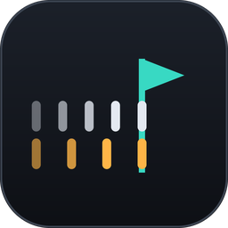
</p>

<h1 align="center">CPX</h1>
<p align="center"><b>Click Polytempo eXtended</b><br>
IsodaLab<br>
<i>Free professional audio software, created for the global audio community.</i></p>

<p align="center">
  <a href="https://github.com/isodalab/cpx/releases/tag/v1.0.0"><b>Download 1.0.0</b></a> ·
  <a href="#install-on-windows">Install on Windows</a> ·
  <a href="#install-on-macos">Install on macOS</a> ·
  <a href="#install-on-linux">Install on Linux</a> ·
  <a href="#using-cpx">Using CPX</a>
</p>

<p align="center">
  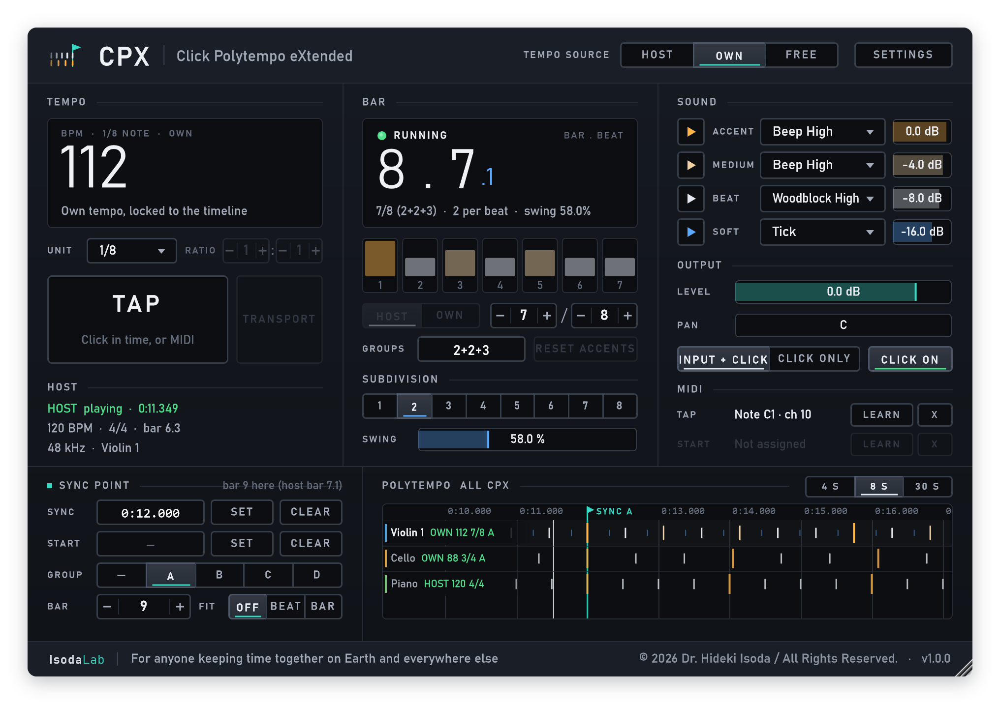
</p>

**CPX is free plug-in software for anyone keeping time together on Earth and everywhere else.** It is a click track generator that doesn't have to follow your DAW's tempo. Put one CPX on each track that needs its own click, give each its own tempo and meter, and record them all at once. Set a **sync point** on the timeline, and every CPX meets there on a downbeat, exactly to the sample, however different their tempos.

The built-in metronome of a DAW, and most click plug-ins, follow the host's tempo: one tempo for everyone. Contemporary music often needs more: two ensembles at independent tempos that converge at a given moment, a soloist in 7/8 against an orchestra in 3/4, a part at exactly 3:2 of the main tempo, a click that keeps running after the transport stops. CPX does all of these, and every click lands on its exact sample.

CPX is a VST3 plug-in for **Windows**, a VST3 and Audio Unit plug-in for **Macs with Apple silicon**, and a VST3 and LV2 plug-in for **Linux**. In your DAW it appears as **CPX** by **IsodaLab**, among the effects (VST3 category *Generator*).

## Download

| Platform | Package | Requirements |
|---|---|---|
| **Windows** | [IsodaLab-CPX-1.0.0-Windows.zip](https://github.com/isodalab/cpx/releases/download/v1.0.0/IsodaLab-CPX-1.0.0-Windows.zip) | 64-bit Windows 10 or 11, a VST3 host |
| **macOS** | [IsodaLab-CPX-1.0.0-macOS-AppleSilicon.dmg](https://github.com/isodalab/cpx/releases/download/v1.0.0/IsodaLab-CPX-1.0.0-macOS-AppleSilicon.dmg) | Mac with Apple silicon (M1 or later), macOS 11 or later, a VST3 or Audio Unit host |
| **Linux** | [IsodaLab-CPX-1.0.0-Linux-x86_64.zip](https://github.com/isodalab/cpx/releases/download/v1.0.0/IsodaLab-CPX-1.0.0-Linux-x86_64.zip) | 64-bit Linux (x86_64), glibc 2.35 or later (Ubuntu 22.04+, Debian 12, Fedora 36+, Arch, …), a VST3 or LV2 host |

The Windows and Linux packages contain the plug-in, a step-by-step install guide, the Quick Start guide and the license; the Linux package adds a small install script. The macOS disk image contains an installer that puts both the VST3 and the Audio Unit in place, with the same guides. [SHA256SUMS.txt](https://github.com/isodalab/cpx/releases/download/v1.0.0/SHA256SUMS.txt) lists the checksums. There is no account and no license key; installation takes about a minute.

## What it does

- **A tempo of its own, or the host's.** *HOST* follows your DAW's tempo map, at any ratio (3:2, 5:4, …). *OWN* keeps CPX's own tempo, locked to the timeline, so every pass, loop and punch-in clicks in the same place. *FREE* runs on its own clock, with START and STOP.
- **Sync points.** Choose a place on the timeline and the bar that begins there. Every CPX in the same group meets on that downbeat, to the sample, whatever its tempo and meter. *FIT* can nudge a tempo so a whole number of bars lies between a start point and the sync point.
- **Any meter.** 1 to 32 beats on any note value from 1 to 64 (so also 4/3 or 3/10), grouped as you count it: 2+2+3, 3+3+2, …
- **Accents you can see.** One cell per beat, which lights as it plays; click it for Accent, Medium, Beat, Soft or Off.
- **Subdivisions and swing.** 1 to 8 clicks per beat, with swing from straight to 75%.
- **15 sounds.** Beeps, woodblocks, clave, cowbell, rim, sticks, hi-hat, shaker, kick, tick, bell, blip: synthesised, each normalised to the same peak, with its own level per accent.
- **Tap tempo.** On the screen, or from any key, pad or pedal by MIDI learn, timed to the sample.
- **Every CPX at a glance.** The polytempo view shows each CPX in the project as a lane on the timeline, with the sync points where they meet.
- **Transparent.** The track's audio passes through untouched; the click is added to it, with zero latency.

## Install on Windows

1. **Unblock the download.** Right-click the ZIP → **Properties**. At the bottom of the *General* tab, tick **Unblock** (1), then click **OK** (2). Do this *before* extracting, so Windows doesn't flag every file inside.

   <p align="center">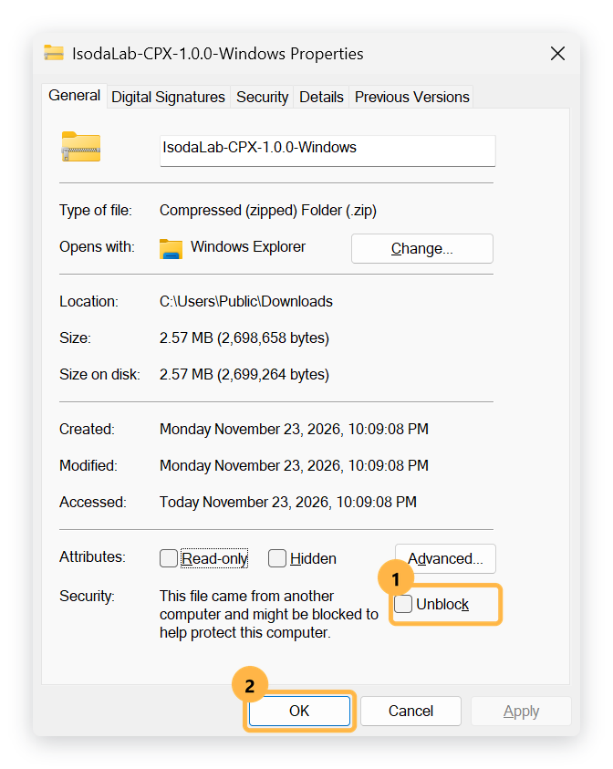</p>

2. **Extract and copy.** Right-click the ZIP → **Extract All…**, then copy the **`IsodaLab CPX.vst3`** folder into `C:\Program Files\Common Files\VST3\`. Click **Continue** when Windows asks for administrator permission.
3. **Rescan plug-ins** in your DAW (see [Finding CPX in your DAW](#finding-cpx-in-your-daw)).

<details>
<summary><b>If Windows or your browser blocks it</b></summary>

CPX is free and isn't code-signed with a paid certificate, so Windows treats it as *unrecognized*. It contains no network code and collects no data.

| What you see | What to do |
|---|---|
| **Edge:** "…isn't commonly downloaded" | Hover over the download, click **…** → **Keep** → **Show more** → **Keep anyway**. |
| **Chrome:** "Suspicious download" | Click **Keep** in the downloads list. |
| Your antivirus quarantines the files | Restore them and add an exception for the `IsodaLab CPX.vst3` folder. |
| **Smart App Control** (Windows 11): your DAW lists CPX as failed, or doesn't show it after a rescan | Smart App Control can refuse unsigned plug-ins and has no override. The only way around it is to switch it off under *Windows Security → App & browser control → Smart App Control settings*. On many Windows 11 versions it can't be switched back on without resetting Windows, so weigh that before you do it. |

</details>

## Install on macOS

1. **Download** `IsodaLab-CPX-1.0.0-macOS-AppleSilicon.dmg` and double-click it. It opens with the installer, the guides and the license.

   <p align="center">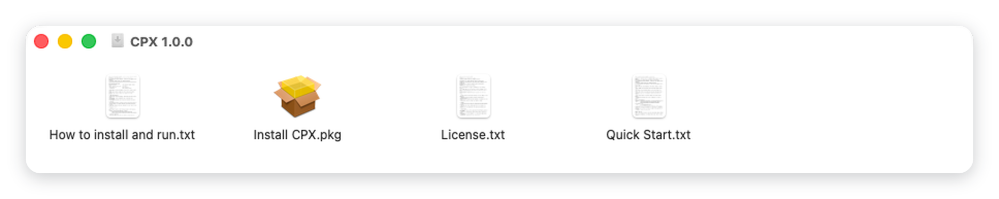</p>

2. **Double-click `Install CPX.pkg`.** macOS shows an alert saying it was *Not Opened*. That's expected: CPX is free and isn't notarized with a paid Apple Developer ID. Click **Done** (1), not *Move to Trash*.

   <p align="center">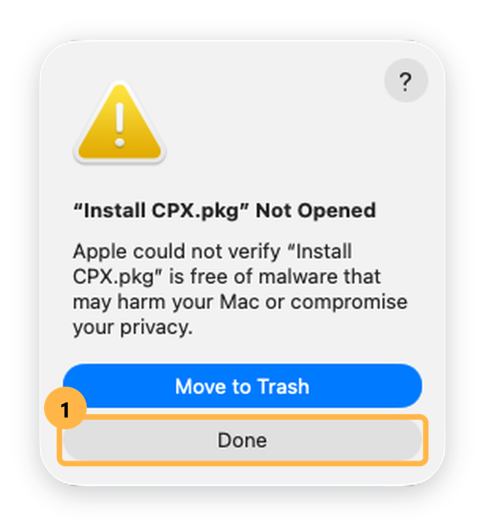</p>

3. **Open System Settings → Privacy & Security** and scroll down to **Security**. Next to *"Install CPX.pkg" was blocked to protect your Mac*, click **Open Anyway** (2). Enter your password (or use Touch ID) and confirm with **Open Anyway**.

   <p align="center">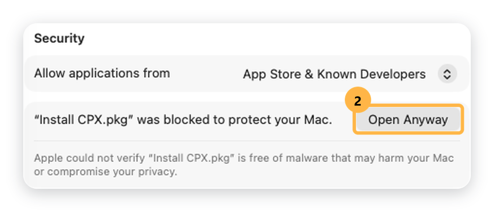</p>

4. **The installer opens.** Click **Continue**, **Agree** to the license, then **Install**. It puts both the VST3 and the Audio Unit in place.

## Install on Linux

1. **Extract** the download with your file manager, or in a terminal:

   ```bash
   unzip IsodaLab-CPX-1.0.0-Linux-x86_64.zip
   ```

2. **Run the install script** from the extracted folder:

   ```bash
   cd IsodaLab-CPX-1.0.0-Linux-x86_64
   ./install.sh
   ```

   It copies the VST3 to `~/.vst3` and the LV2 to `~/.lv2`, so no root password is needed. Running it again updates an existing installation; `./install.sh --uninstall` removes CPX. (If your file manager extracted it without the executable bit, run `sh install.sh`.)
3. **Rescan plug-ins** in your DAW (see [Finding CPX in your DAW](#finding-cpx-in-your-daw)).

## Finding CPX in your DAW

CPX is listed as **CPX** by **IsodaLab**, an audio effect (VST3 category *Generator*). If it doesn't appear, rescan your plug-ins:

| DAW | How to find CPX |
|---|---|
| **Ableton Live** | Settings → Plug-Ins → turn on the VST3 system folder (and Audio Units on a Mac) → **Rescan**. |
| **Ardour / Mixbus** | Edit → Preferences → Plugins → **Scan for Plugins**. On Linux, CPX is available as VST3 and LV2. |
| **Bitwig** | Settings → Locations (on Linux, make sure `~/.vst3` is listed); Bitwig rescans on start. |
| **Carla** (Linux) | Add Plugin → **Refresh**. |
| **Cubase / Nuendo** | Studio → VST Plug-in Manager → Rescan all. If CPX is listed as blocklisted, select it and click **Reactivate**. |
| **Digital Performer** | DP checks plug-ins when it starts. If CPX is missing, open Preferences → Audio Plug-ins, make sure CPX is enabled, and restart DP. |
| **FL Studio** | Options → Manage plugins → **Find installed plugins**. |
| **GarageBand** | Settings → Audio/MIDI → tick **Enable Audio Units**. |
| **Logic Pro** | Logic Pro → Settings → Plug-in Manager. If CPX shows *failed*, select it and click **Reset & Rescan Selection**. Insert it from an Audio FX slot → Audio Units → IsodaLab → CPX. |
| **Pro Tools** | **Not supported.** Pro Tools only loads plug-ins in Avid's AAX format. |
| **Pyramix** (Windows) | Pyramix picks CPX up from the standard VST3 folder. Restart Pyramix after installing (listed under IsodaLab). |
| **Qtractor** (Linux) | View → Options → Plugins: make sure `~/.lv2` (or `~/.vst3`) is among the paths, then restart Qtractor. |
| **Reaper** | Settings → Plug-ins → VST → **Re-scan** (on Linux, make sure `~/.vst3` is in the path list). |
| **Renoise** | Preferences → Plug/Misc → **Rescan**. |
| **Sequoia Pro** (Windows) | Make sure `C:\Program Files\Common Files\VST3` is among Sequoia's VST plug-in folders, then rescan or restart Sequoia. |
| **Studio One** | Settings → Locations → VST Plug-Ins → **Reset Blocklist**, then restart. |
| **Tracktion Waveform** | Settings → Plugins → **Scan for new plugins**. |

## Using CPX

**Put CPX on a track that reaches the musician's headphones**: an empty audio track, an FX or group channel, or the musician's own track (with *Input + Click*, that track's audio passes through untouched). For different clicks for different players, use one CPX per track and send each track to that player's cue mix. Two players on one stereo feed: pan one CPX hard left and the other hard right. To keep the clicks out of the mix, send the CPX tracks only to the cue mixes.

### Tempo source

| Source | The click… |
|---|---|
| **HOST** (default) | Follows your DAW's tempo map and position, like its own metronome. **Ratio** plays it at any proportion of the host's tempo: 3:2 is three CPX beats in the time of two host beats. **Meter** takes the host's time signature or CPX's own. |
| **OWN** | Keeps CPX's own tempo, locked to the timeline: wherever you start, loop or punch in, the click is in the same place. This is the mode for sync points. |
| **FREE** | Runs on CPX's own clock, independent of the transport. **Start** begins at bar 1 at once, **Stop** stops; a tempo change continues smoothly from where it is. |

Drag the tempo up or down (with Shift, in 0.01 steps), scroll, or double-click and type: 20 to 400 BPM. **Unit** is the note the BPM counts: 1/4, 1/8, a dotted 1/4 for 6/8 in two, or *Beat* (the meter's lower number).

### Sync points: different tempos that meet

<p align="center">
  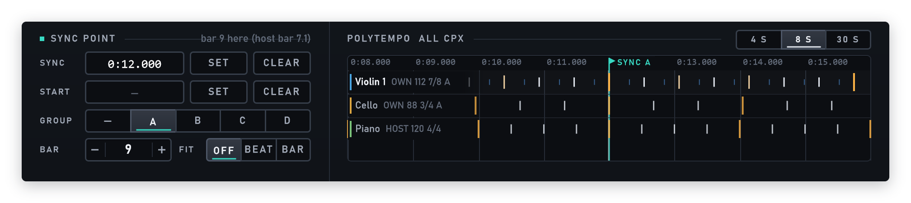
</p>

A sync point is a place on your DAW's timeline where this CPX's bar *Bar* begins, exactly. The click's grid runs through it in both directions, so a CPX at 112 BPM in 7/8 and one at 88 BPM in 3/4 with the same sync point both have a downbeat there, although they never coincide on the way.

1. Park the playhead where the clicks must meet and press **Set** next to *Sync*, or type the time (h:mm:ss.mmm on the timeline).
2. **Bar:** which bar of this CPX begins there (the bars before it count down to it).
3. **Group A to D:** every CPX in the same group shares one sync point. Set it in one, and it moves for all.
4. **Start** (optional): no clicks before this point.
5. **Fit:** *Beat* or *Bar* adjusts the tempo slightly so a whole number of beats, or bars, lies between the start (or 0:00) and the sync point; then the start falls on a beat or a downbeat too.

The **polytempo view** shows every CPX in the project as a lane on the timeline, with its clicks, the sync points (teal) and the playhead. With the transport stopped it centres on the sync point, so you can check that the lanes meet before you record.

### Meter, groups and accents

<p align="center">
  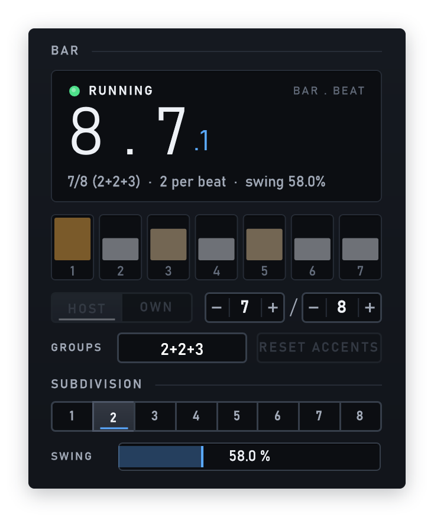
</p>

Set the beats per bar (1 to 32) and the beat value (any number from 1 to 64). **Groups** say how you count the bar: type the group sizes, which must add up to the beats per bar. Beat 1 gets the **Accent**, the first beat of every other group a **Medium** accent, all other beats a **Beat** click. Groups never change *when* the clicks happen, only which are stronger.

| Meter | Groups | Accent on | Medium on |
|---|---|---|---|
| 5/8 | 3+2 | 1 | 4 |
| 7/8 | 2+2+3 | 1 | 3, 5 |
| 8/8 | 3+3+2 | 1 | 4, 7 |
| 9/8 | 2+3+4 | 1 | 3, 6 |
| 11/16 | 3+3+3+2 | 1 | 4, 7, 10 |
| 6/8, 9/8, 12/8 | *(empty)* | 1 | every third beat |

If the groups don't add up to the bar, a small amber mark appears and they are ignored. Then click any **beat cell** to change it: Accent → Medium → Beat → Soft → Off (right-click for a menu); *Reset Accents* returns to the groups' pattern. To hear only the group starts, set the beats inside the groups to Soft or Off.

**Subdivision** adds 1 to 8 clicks per beat (3 = triplets, 5 = quintuplets), with the Soft sound. **Swing** delays every second subdivision: 50% straight, 66.7% a triplet feel, up to 75%.

### Sound

One sound and level for each kind of click: **Accent**, **Medium**, **Beat** and **Soft** (subdivisions), with a play button to hear it; all the way down is off. Every sound peaks at the same level, so the levels compare. **Output** sets the level (up to +12 dB) and the pan. **Input + Click** keeps the track's audio, **Click Only** mutes it, and **Click On / Muted** silences the click without losing its place.

### Tap tempo and MIDI

<p align="center">
  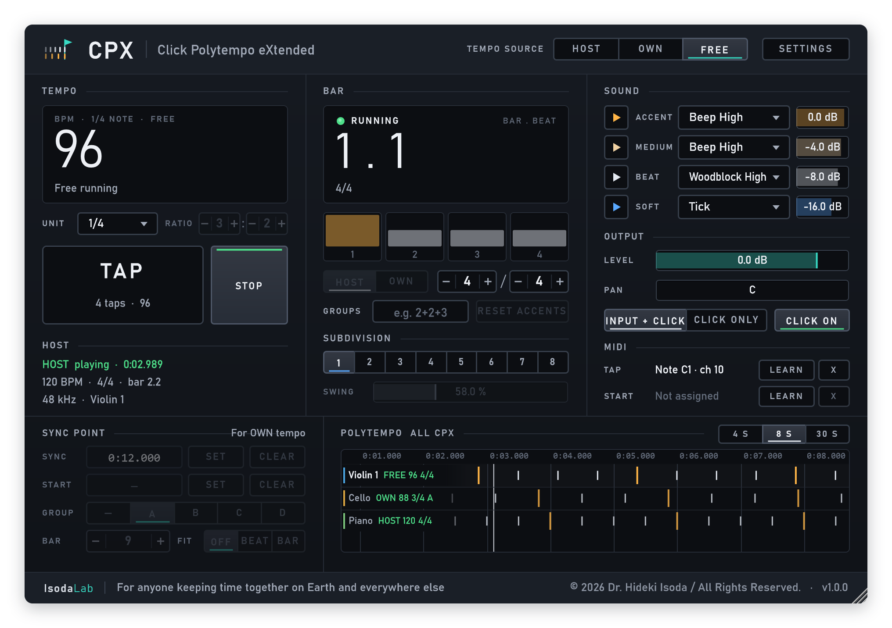
</p>

Click **Tap** in time: after two taps CPX takes the tempo, averaging the last taps (4 to 12, in Settings). Each tap is one tempo unit. A pause of 2.5 s, or a clearly different tempo, starts again.

For **MIDI tap**, click **Learn** next to *Tap* and press a key, pad, footswitch or controller button; from then on it taps. **Start** learns a control that starts and stops *FREE*. MIDI reaches CPX from your DAW (route a MIDI track to it; taps from the DAW are timed to the sample; in Logic Pro, choose the MIDI input as the plug-in's side chain), or directly from the computer's MIDI inputs (Settings → *MIDI Devices*: needed in Ableton Live, which doesn't send MIDI to audio effects).

### Following the host

<p align="center">
  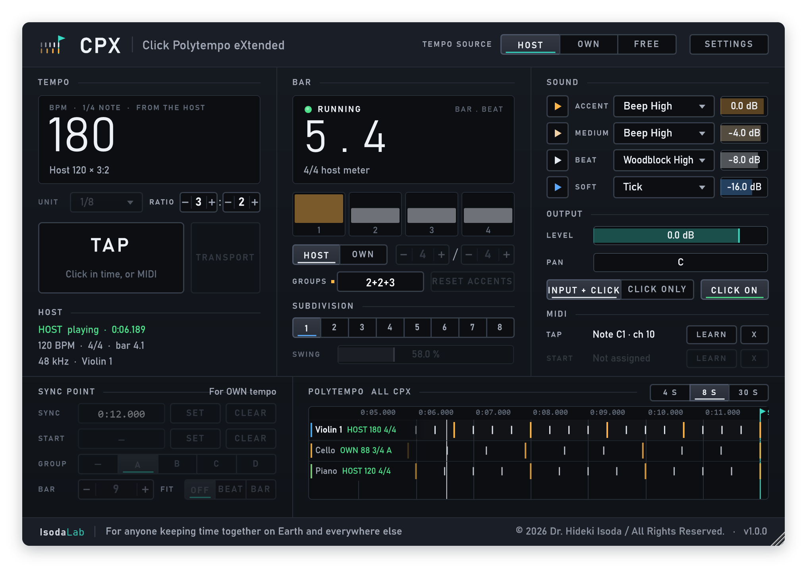
</p>

### Settings

<p align="center">
  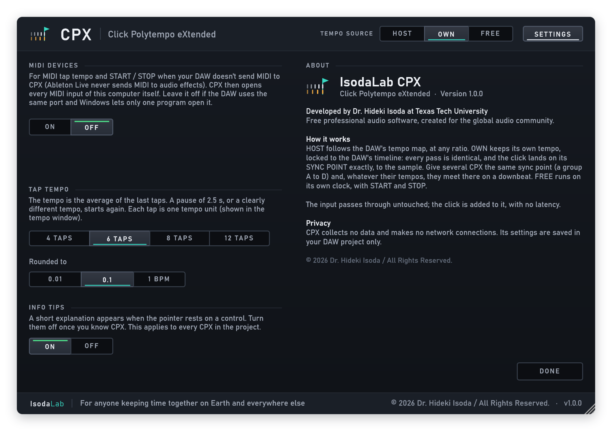
</p>

- **MIDI devices:** listen to every MIDI input of the computer directly, and see which ones CPX hears.
- **Tap tempo:** how many taps are averaged, and the rounding (0.01, 0.1 or 1 BPM).
- **Info tips:** the short explanations that appear when the pointer rests on a control; turn them off once you know CPX (for every CPX in the project).

### Good to know

- Everything (tempo, meter, accents, sync point, MIDI assignments) is saved with your DAW project.
- The click is placed on your DAW's timeline, like any instrument track, and your DAW's latency compensation applies to it as usual.
- Hosts never put CPX to sleep on a silent track: it tells them its output never ends.
- In *OWN*, a tempo change moves the whole grid around the sync point. To change tempo during a take, use *FREE* or *HOST*.
- The beat lamps run a few milliseconds ahead of what you hear (the audio is computed a little before it is played).

## Privacy

CPX collects no data. It makes no network connections, has no analytics or telemetry, and needs no account, registration or license key. It passes the audio through unchanged, adding only the click, on your own computer. Its settings are stored in your DAW project, nowhere else. It opens your computer's MIDI inputs only if you turn on *MIDI Devices*, and only to receive tap tempo and start / stop.

## License

CPX is **freeware**: free for personal, educational and commercial use on any number of computers. You're welcome to share the unmodified packages with anyone, free of charge, with the license and copyright notice intact. It is not open source. The full terms are in [LICENSE.txt](LICENSE.txt).

Built with the [JUCE](https://juce.com) framework. VST is a registered trademark of Steinberg Media Technologies GmbH; Audio Units is a trademark of Apple Inc. The macOS and Linux versions embed the Barlow typeface (SIL Open Font License 1.1). Windows is a trademark of Microsoft Corporation; macOS of Apple Inc.; Linux is a registered trademark of Linus Torvalds.

## About

Developed by **Dr. Hideki Isoda** at **Texas Tech University**. Created as a contribution to the global audio community, this software is provided free of charge to support audio professionals, educators, students, and researchers worldwide.

This project is entirely self-funded, and I have not applied for any grants. I also see it as a good example for the Music Informatics and Recording Technology courses I teach at TTU, and I hope it inspires my students.

## Transparency

I do use AI tools like ChatGPT or Claude to help organize my ideas and catch errors, but most of the work comes from decades of coding practice and real-world professional experiences. I still design programs like this the old-fashioned way, with notebooks and a whiteboard, before the code takes shape. That said, AI has cut my build time from many months of late nights to weeks!

## Thank you

To my fantastic students and colleagues.

And to my wife, **Hyejin**, who is always supportive of me and my projects.

— Hideki Isoda

<sub>© 2026 Dr. Hideki Isoda / All Rights Reserved.</sub>
